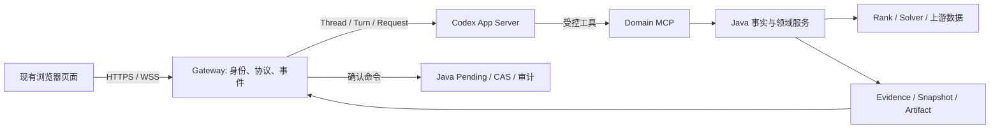

# Codex 原生接入智愿：核心设计与实施入口

> 版本：v2.0；日期：2026-09-20。状态：设计与实施任务书，未代表集成或公网验收完成。
> 代码基线：zhiyuan `4a23d50`，本地 Codex `5c5308f`；PATH 中二进制为 `codex-cli 0.155.1`。源码与运行二进制必须分别验收。

> **2026-10-05 状态修订**：下文第 2 节与第 8 节是 9-20 的历史设计/域名目标，不是当前生产状态。
> 用户实际走的 `test-www` 标准入口与原 C 线的 `test-wwww` 隔离域分轨验收；目前前者的
> `/ws/chat` 升级请求 404，且无需登录的公开 `/inner/planning/...` 返回 200 数据，均为放行阻断。
> B4 推荐与 B5 完整预览仍 PARTIAL，P2 四项写路径只在受控合同栈全绿。
> 最新证据、功能进度、优先级与执行交办见
> [2026-10-05 链路与功能计划复核](superpowers/reviews/2026-10-05-test-www-chain-functional-review.md)；
> 保留原方案的范围和 `test-wwww` 目标，暂不拿 `test-www` 的首页可达替代其 DNS/TLS/WSS 验收。

## 1. 决策与阅读顺序

采用 **现有前端 + 智愿 Gateway + Codex App Server + Domain MCP + Java/Rank/Solver**。把 Codex 作为主要对话运行时，让它负责理解、工具编排、原生提问、历史与压缩；Java 保存业务事实、画像、方案、证据和写入事务。保留 sessionDetailV2 工作台，逐步替换旧对话执行路径。

这比继续让旧 Agent 把 Codex 当一次性的“问答服务”更适合连续填报：同一业务会话绑定长期 Thread，工具与 Skills 直接进入运行时，Gateway 处理明确的协议边界。也不需要把招生业务搬进 codex-rs/core，或将 TUI 移植到浏览器。

| 路线 | 代价 | 结论 |
|---|---|---|
| 旧框架每轮调用一次 Codex | 两套历史、路由、重试、状态机；原生交互难贯通 | 只作为迁移兼容层 |
| App Server 作为主对话 Runtime | 补事件桥、领域契约、确认闭环，复用现有业务与前端 | 本方案 |
| 深度 fork Codex core/TUI 植入业务 | Rust 升级冲突、业务与推理耦合、前端仍需重做 | 首期不采用；仅有明确上游缺口时做最小协议修复 |

可执行任务拆为三份，避免把一个大路线图当作可派发任务：

1. [A：原生交互与前端纵向切片](superpowers/plans/2026-09-20-codex-native-interaction.md)：A1–A7，协议、实时进度、选项卡、恢复、现有页面接线。
2. [B：业务数据、推荐与方案事务](superpowers/plans/2026-09-20-codex-domain-and-plan-transactions.md)：B0–B7，持久产物、证据断点、数据种类、候选、生成、审查、Pending/CAS、Skills。
3. [C：本地与测试域名验收](superpowers/plans/2026-09-20-codex-browser-validation.md)：C1–C5，身份、代理、环境、浏览器与真实数据验证。
4. [复核记录](superpowers/reviews/2026-09-20-codex-native-plan-review.md)：记录子 agent 发现、采纳情况及本轮实际检查边界。

先读本文，再按任务依赖执行。本文中的“新增”都是待实现合同，不是对当前接口的描述。

## 2. 当前进展与必须先修的断点

| 代码落点（相对 zhiyuan） | 已存在 | 尚缺 |
|---|---|---|
| `zhiyuan-agent/app/gateway/composition.py` | 启动 app-server stdio；legacy/shadow/readonly 模式 | 运行二进制能力矩阵、严格工具边界 |
| `app/harness/client.py`、`codex.py`（下同属 Agent） | server request handler、通知队列、turn/steer/interrupt | 提问 handler 接线、队列上限、等待退出唤醒、实时回调 |
| `app/server.py` | 原生 `/ws/chat` 和旧 compat 路由 | 两条路径均等待整轮；compat 不转发中间 events；收包不能及时处理停止 |
| `app/gateway/service.py` | Snapshot、Working Set、输出校验 | tenant+session 键、持久绑定恢复、Snapshot evidence 纳入账本、真实诉求状态 |
| `app/mcp_server/tools_readonly.py` | 8 个只读工具、预算/缓存代码 | 当前实例按调用创建，预算/缓存是否跨本轮生效需修；返回种类混用 |
| `admission.get_current_plan` | 调用 `get_working_plan(chat_session_id)` | **这是用户当前 working-plan，不是年度招生计划** |
| Java `PendingConfirmationBizService` / `PendingPlanningCommandBizService` | active→applying→applied、claim、版本 CAS、operation 重放 | preview 到 Pending 编译；确认后的 execute 与 complete 闭环 |
| `zhiyuan-web/.../sessionDetailV2` | WorkspacePanel、AdmissionFactCard、EvidenceDrawer、PlanningStatus | MessageList 实际消费统一事件、理解/澄清卡、断线恢复 |
| `scripts/start-codex-local.sh` | 四服务隔离启动 | WS 地址硬设 loopback；dev 使用根路径，不是 `/assistant-pc/` |

已有任务仍有效，应合并承接：

- [推进计划修订](superpowers/plans/2026-09-10-对话执行引擎推进计划修订.md)。
- [P1b-2 当前报告](superpowers/tasks/P1b-2-evidence-passthrough/REPORT.md)：仅 scope 与 groupCode 下传已做；保留信封、生产者形状、删除自铸证据未完成，状态 NEEDS_CONTEXT。
- [P1c 三处拒收](superpowers/plans/2026-09-13-P1c证据校验器的三处结构性拒收.md)：Snapshot evidence 漏合并、工作区版本误判事实新鲜度、thread 错当业务证据边界。
- [mixed-read-write 四个成因](superpowers/plans/2026-09-13-P0第二条验收条mixed-read-write的四个成因.md)：工具全成功不能把用户诉求 partial 改成 completed。
- [任务占用与验收账本](superpowers/tasks/LEDGER.md)：同一文件实现必须串行；真实模型验收独占。执行前重新核对占用，不覆盖当前未提交改动。

## 3. 能力与数据契约



### 3.1 不能混用的六种数据

| kind（拟新增） | 必需语义 | 概率是否必需 | 工具落点 |
|---|---|---|---|
| `history` | 年份、省份、批次、选科口径、学校/专业组/专业身份、分数/位次/人数 | 否 | 修复 `admission.get_history` |
| `probability` | 上游已算概率、计量单位、计算口径、画像/位次摘要、招生单元身份 | 是，来自上游 | 新增 `admission.get_probability` |
| `enrollment` | 招生年度、投放省份、专业组/专业、名额、学费、学制、选科条件 | 否 | 新增 `admission.get_enrollment_plan` |
| `policy` | 年度、学校、原文条款、官方出处、适用条件、抓取时间 | 否 | 新增 `admission.get_policy` |
| `eligibility` | eligible/ineligible/unknown 与逐项理由；缺条件不是 false | 否 | 修复 `admission.check_eligibility` |
| `workingPlan` | 用户当前草案、来源工作区版本 | 否 | `planning.get_working_plan`；旧工具名兼容一个发布周期 |

每种结果统一外层：`{schemaVersion:1, kind, status, data, evidenceRefs, limitations, nextCursor}`；`status` 为 `ok|empty|insufficient_data|unsupported|upstream_error`，`data` 按 kind 校验。外层统一不意味着把历史分数强行转成需要录取率的 AdmissionFact。

“上游已计算”是业务前提，但并不证明当前 score-line DTO 带概率。先接实际概率接口/候选结果，不自算、不用历年最低分伪造、不补默认零。缺少真实接口时该能力显示不可用，其他数据查询继续可验收。

“最新招生计划”按官方发布年份返回，未发布当年时明确标记最近已发布年份；不能把去年称作今年。“招生章程”以原文条款为依据，模型解释与原文并列；不从专业百科推断资格。

### 3.2 证据、产物与上下文

- 权威 Evidence 由 Java 真实取数路径签发，ID、内容摘要与来源原样透传；概率事实可引用对应 evidence，不自行生成 authoritative ID。
- 业务权限边界为 `(tenantId, sessionId)`；threadId 为运行/审计身份。重建 Thread 不能让合法的历史招生事实失效。
- 招生事实新鲜度由来源参数摘要、内容摘要与有效期核验；用户方案的 stateVersion 改变不等于录取数据过期。Artifact 仍检查它依赖的画像/方案版本。
- Working Set 注入画像摘要、已确认约束、活动 Proposal、最近证据引用和分页产物摘要。建议预算：画像 600 tokens、工作区 800、证据摘要 800、近期任务 400；单项超过 1k 要人工复核，任何单项不超过 10k；实际 token 计数写入验收报告。
- B0新增当前尚不存在的Java Artifact存储；大候选表保存在其中，模型只拿 Top N（默认 20，硬上限 50）与分页游标。不得每轮重写整个 Thread 历史；compaction 后以 Java Snapshot 重建业务摘要。

## 4. 用户理解与 Codex 原生交互

本地源代码支持下列能力；官方网页本轮返回 HTTP 403，结论以本地源代码为依据，不能据此声称部署二进制/模型全部可用。

| 原生能力 | 真实语义与产品处理 |
|---|---|
| `item/tool/requestUserInput` | 服务端→客户端 JSON-RPC request，有 request id；按相同 id 回答；不是 notification |
| `mcpServer/elicitation/request` | MCP 的结构化表单/URL 请求；不是业务写入授权；首期仅接允许的 form，拒绝不支持的 URL 流程 |
| `turn/steer` | 给活动 Turn 补充内容，带 expectedTurnId；不能替代上述请求的 result |
| `turn/interrupt` | 请求停止模型回合；不能撤回已提交 Java 事务 |
| `item/started` / `item/completed` | 可靠的工具开始/结束观测；item 嵌在 params 中 |
| `item/mcpToolCall/progress` | 协议存在；本地 MCP 客户端 progress 发送链未证明接通，首期不依赖百分比 |
| `turn/plan/updated` | 模型执行计划，可以显示脱敏摘要；不是用户的志愿表 |
| `item/agentMessage/delta` | 当前输出契约包含 JSON；必须缓冲校验，不能原样流给用户 |

源码定位：`../codex/codex-rs/app-server-protocol/src/protocol/common.rs`，`v2/item.rs`，`v2/mcp.rs`，`core/src/tools/handlers/request_user_input.rs`，`app-server/README.md`。

本地 `request_user_input` 默认 Plan 模式可用；Default 模式须确认 `features.default_mode_request_user_input=true`，且 tool 配置未禁用。业务会话不应为了显示选项卡强制进入 Plan 模式。A1 用实际二进制、实际 provider 测握手和问答；未通过时采用结构化终态 clarification，用户提交后开启下一 Turn。两条路径使用同一张卡，requestOrigin 明确为 native 或 gateway，不同时发送两份问题。

异步 `request_user_input_async` 是另一条能力：依赖模型目录声明，输出带 `delivery:"async"`/questions 的 agentMessage，不产生同步 pending request id；首期不启用，不能与本文同步问答桥混接。标准 MCP form 在特定审批/沙箱组合下还要求 initialize 的 `openai/standard-form-input` 扩展能力和 `threadSource:"user"`，由 A1 验证。

### 4.1 三种确认分开

1. **理解反馈**：明确问题可以直接查；显示“正在查询近三年录取位次”等事实性阶段。没有模型结构化理解时不预制“我理解你想……”的卡。
2. **澄清**：实体歧义、缺省份/年份/选科、偏好冲突时提出当前最必要的问题。每轮 1–3 问，每问通常 2–3 个互斥选项并支持自由输入；“不确定”必须允许。避免每轮都强制确认理解。
3. **变更授权**：展示 Java 编译的 Proposal diff、影响范围、版本、限制；只有点击确认该 Proposal 才进入事务。回答“计算机类”或“优先北京”不等于批准写入。

理解卡的来源限于通过校验的公开结构化理解摘要、原生问题、或真实工具事件。Gateway 的固定阶段标签只解释正在发生的操作，不推测用户意图。原生 reasoning/系统指令/MCP 参数/claimToken 不进 UI。

### 4.2 用户路径

| 用户输入 | 流程 | 完成证据 |
|---|---|---|
| “查某校计算机近三年录取” | 复用已知省份选科→实体解析→有歧义才提问→历史查询 | 年份和口径一致的表格、来源 |
| “我能上吗” | 补必要画像→上游概率→限制解释 | 显示概率单位与计算条件，不承诺录取 |
| “A 和 B 哪个适合我” | 同口径对比→硬约束筛除→软偏好比较 | 比较矩阵、证据、缺项；不把 Rank 分当概率 |
| “帮我填完整志愿表” | 校验填报规则与画像→候选→Rank/Solver→审查→完整预览→确认 | 满足该省招生单元/数量/组内规则的正式方案 |
| “保守一点，别改锁定项” | 引用当前方案→用户目标 Proposal→diff→确认→CAS→再审查 | 前后差异、锁定项保持、实际结果版本 |

## 5. 固定的前后端事件合同（拟新增 v1）

保留现有 compat 连接地址与旧 text 消息解析。协商 `protocolVersion:1` 后服务端发送统一 envelope；未协商时保持旧终态输出。两种格式不可同时生成两份终态消息。

```json
{"protocolVersion":1,"type":"turn.phase","sessionId":"42","turnId":"ui-turn-1","streamEpoch":"epoch-1","sequence":8,"payload":{"phase":"querying_evidence","status":"started","label":"正在查询历年录取"}}
```

- 客户端生成稳定 `turnId` 和 `clientRequestId`；Gateway 分开保存 `codexThreadId/codexTurnId`，不混用两个 turn ID。
- `sequence` 在 **tenant+session+streamEpoch 范围**单调，分配与追加原子完成；重连 cursor 为 `{streamEpoch,lastSequence}`。Redis 日志重建产生新随机 epoch，客户端先比较 epoch，不能把两代相同序号视为重复。
- event types：`turn.started`、`turn.phase`、`tool.progress`、`understanding.preview`、`clarification.requested`、`clarification.resolved`、`proposal.preview`、`conversationAction.result`、`assistant.completed`、`turn.completed`、`recoverable.error`、`session.resync`。
- **沿用** `conversationAction.result` + `actionResult.actionStatus`；不另造 `action.result.status`。actionStatus 为现有 UI 语义 `applying|applied|cancelled|expired|stale_state|failed`。
- `assistant.completed` 仅包含通过业务验证的答案/卡片；`turn.completed` 是运行结束，不代表用户诉求全部完成；包含 `executionStatus` 与 `toolStatus` 两个不同字段。
- 首期不发送 `assistant.delta`：真实进度即时显示，事实答案最终校验后显示。后续若开放文字流，应另设受限 presentation channel，不能增量解析尚未闭合的 TurnOutput JSON 当答案。

客户端入站继续使用 `content` 字段（控制消息为空串），新增 `type=clarificationAnswer|turnInterrupt|turnSteer|sessionResume`；旧确认仍 `type=chat` + `conversationAction`。未知字段/类型返回可恢复协议错误。

```json
{"protocolVersion":1,"type":"clarificationAnswer","sessionId":"42","turnId":"ui-turn-1","clientRequestId":"answer-1","content":"","clarificationAnswer":{"requestId":"ui-question-1","inputKind":"choice","answers":{"major":{"answers":["计算机科学与技术"]}}}}
```

MCP form使用独立 `inputKind:"form"`，响应包含typed `content` 与accept/decline/cancel；不能塞进choice的answers数组。

Gateway 以不可预测 UI requestId 映射 `(runtimeGeneration, rpcId, tenant, session, codexThread, codexTurn, questions, expiresAt)`。浏览器不能指定可信 tenant、用户身份或 rpcId。原生回答按保存的 JSON-RPC id 回传；gateway clarification 则将答案作为用户新增消息推进下一轮。

## 6. 并发、恢复与失败语义

### 6.1 会话运行

每个已鉴权 session 至多一个活动推理 Turn。WS 接收器独立处理 ping、回答、停止、resume；工作任务在后台推进；唯一发送器串行输出队列。新的普通 chat 在活动时返回 `turn_busy`，另有明确 steer 操作才转 `turn/steer`，不隐式取消上轮。

stdio 只有一个 reader。Harness collect 独占匹配的通知，回调 Gateway 分发；禁止再开一个 `next_event()` 消费者竞争同一队列。未匹配通知设数量/TTL 上限，进程退出唤醒所有 pending 和 notification waiter。

### 6.2 持久化选择

首个可公网验收版本限定 **一个 Gateway worker**，同一租户会话串行锁；Redis 保存事件和 admission request 去重记录，Java 保存业务状态和 ThreadBinding。不得开多 worker 后仍依赖进程内锁。

- Redis 原子 append：session counter + bounded stream；保留最多 2,000 事件/会话、24 小时，单事件 ≤16 KiB；大数据只存 Artifact 引用。开启测试实例 AOF，每秒刷盘；因此承诺至少一次投递与可能 resync，不承诺零丢失事件。
- 同一个 clientRequestId 与相同内容返回原结果/活动状态；同 ID 不同内容报冲突。记录 24 小时；过期写操作仍由 Java operationId/Pending 幂等保护。
- `lastSequence` 不在保留窗口、Redis 计数丢失或客户端 cursor 超前：发 `session.resync`，读取消息历史、当前 workspace、当前 Pending；同时从 SessionRuntime/UserInputBroker 读取仍活动的 Turn、待答卡与 expiresAt，不编造历史工具过程。resync 是控制快照，先于普通 sequence 去重处理，允许重置到新 epoch/sequence=0。
- 运行中断线保留任务最多原有回合 deadline；重新鉴权后附着。用户点击停止才请求 interrupt。等待回答有 10 分钟独立期限，单次模型运行总预算另计；超时卡变 expired。
- 问题过期先 interrupt 原 Turn 并等待终态，不能仅回 RPC error（可能被 Runtime 当空答案继续）；收到 serverRequest/resolved 后禁止迟到回包。Gateway/App Server 重启使未回答原生请求失效；恢复业务快照和问题摘要，开启新 Turn 重新提问。JSON-RPC request 不跨进程复活。
- Thread 恢复先用 Java 根据 tenant+session 查询绑定（需新增 lookup）；执行 `thread/resume`。找不到 rollout/版本不兼容时建立新 Thread、重新注册、加载权威 Snapshot，不丢业务状态。

### 6.3 写操作边界

Java 当前 Pending 真值为 `active|applying|applied|cancelled|expired`；UI failed 是错误展示，不能假装数据库已有 failed 状态。Pending revision、workspace version、数据版本是三种不同版本。

preview 必须编译并持久化 active Pending，保存稳定 operationId、Proposal/diff 摘要、sourceVersion、允许命令参数。确认走 `claim → execute → complete → reread workspace`；不能停在 resolve(confirm) 就显示 applied。完整生成的预览不能偷偷调用会保存正式方案的 generate 接口。

网络超时得到的是“结果未知”，先按 operationId 查命令/重放；不新造 operationId 重做。事务失败必须回滚；命令成功但 Pending complete 尚未完成时以原 operationId 恢复并补齐 complete。版本冲突使 Proposal 失效并重新预览，不自动确认新方案。

后端 applying 时不提供“已取消”按钮。停止推理不能撤销已提交事务；显示“操作结果确认中”，最终按 Java 结果刷新。正式方案可一次命令推进多个内部版本，验收比较 Java resultPlanVersion，不规定必须 +1。

现有 `/review/run` 会保存 reviewState、推进 workspaceVersion，虽不改志愿内容也不是数据库只读。UI 应准确披露“更新审查结果”，后续 Proposal 使用审查后的版本；只想看已存报告则调用读取接口。

## 7. Skills 和工具权限

复用现有 `zhiyuan-agent/skills/codex/` 六个技能：`profile-discovery`、`school-major-exploration`、`admission-fact-analysis`、`candidate-recommendation`、`plan-construction`、`plan-final-review`，以及现有 references。技能承载提问顺序、解释方法、审查经验，不存最新分数线或替代后端约束。

每个技能写清输入前提、允许工具、结果类型、证据引用、缺项提问、完成条件与禁止推断；用场景评估按需加载，稳定 base instructions，避免每轮塞完整技能全文。源码无需内嵌业务技能。

MCP 只暴露明确 schema 的领域读取、计算和 Proposal 工具，身份来自服务端 ThreadBinding。默认禁用 shell、任意 HTTP、代码执行、文件写入。仅设置 read-only sandbox/approvalPolicy 不足以证明工具不可调用；A1 要检查有效工具清单，B7 做越权工具行为验收。

## 8. 前端与测试域名

保持现有 `MessageList`、`WorkspacePanel`、`ConversationEvents/AdmissionFactCard.tsx`、`ArtifactRenderer.tsx`、`EvidenceDrawer.tsx`、`PlanningStatus.tsx`；新增组件也放在 `ConversationEvents/`。不建立一套平行的 `src/components/conversation`。

页面按“对话、候选/对比、当前方案、审查依据”聚焦已有工作区。理解卡只在有信息时出现；时间线根据实际事件更新，无伪造固定三阶段；澄清卡支持键盘/自由输入/过期；Proposal 展示确认与取消，重复点击本地锁定并由服务端幂等。

目标域名采用用户给定的 **`test-wwww.gaotuzhiyuan.com`**。已有环境文件的 `test-www` 是另一域名，必须验证 DNS、证书和 Cookie，不自动改用它。dev 栈以 `/` 页面路径验收；若采用 `/assistant-pc/`，必须配套 APP_ENV/basePath 重新构建并另测。

浏览器 WS 使用同源 `wss://test-wwww.gaotuzhiyuan.com`；Java/Agent/Rank 使用 loopback 内网地址。NEXT_PUBLIC 变量按构建时固化处理，修改后重启 dev/重建 production。代理显式覆盖 `/ws/chat` 与 compat 前缀；公开入口拒绝 `/inner/`，前端当前 inner 调用迁至带登录和 session ownership 的 public facade 后再开放。

## 9. 任务依赖、首批交付与验收口径

```text
A1 → A2 → A5（事件存储）→ A3 → A4 → A6 → A7
           B0（持久产物/幂等）→ B1 → B2 → B3 → B4 → B5 → B6 → B7
C1（可先做）+ A7 + B6 → C2 → C3 → C4 → C5
```

A/B 同改 Gateway、MCP 或 output schema 时串行提交；其他只读审查可并行。第一批最小可落地结果是 **A1–A6 + B0–B2**：一个学校历史查询，实时工具阶段，一张必要澄清卡，一个带证据的最终答案；再加入恢复、业务扩展与公网入口。

| 用户需求 | 任务 | 核验 |
|---|---|---|
| 精确查学校/专业、历史 | B1/B2、A4 | 同名歧义、跨年口径、数组信封、Evidence |
| 上游概率、年度计划、章程 | B2/B3 | 三条真实数据 fixture，缺字段 fail closed |
| 推荐与比较适配性 | B4/B7 | 约束排除、Rank解释、概率与适配分分离 |
| 完整方案/调整/审查 | B5/B6 | 预览不写正式表、CAS、锁定项、postcondition |
| 原生上下文/Skills | A1/A7/B7 | 重建 Thread、压缩后引用、上下文大小 |
| 理解/选项/执行披露 | A2–A6 | 原生同 id 回答、进度早于终态、无 JSON 泄漏 |
| 本地/域名验证 | C1–C5 | 浏览器实际请求、WSS、权限、恢复、真实数据 |

每条确定性测试必须全过；真实模型用固定场景集、固定调用次数统计通过/失败/环境错误，不能只挑连续三次成功。报告区分 fixture、真实 Java+上游、真实 Codex、真实浏览器四层证据；样本量不够不宣称生产可靠性。

关闭写能力的回滚优先于切换整个 Runtime：保留日志/Pending/业务结果，停止新 Proposal，已 applying 的 operation 先对账。再将新会话切到 legacy；不重放失败回合，不自动重复写。数据库迁移采用增量，不靠删表回退。
